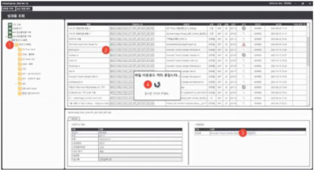

# CobimExplorer

## 데모 (프로그램 실행 화면)

**파일 다운로드**



## 개요

`CobimExplorer`는 국토교통부 COBIM 연구과제에서 개발한 **Windows WPF 데스크톱 탐색기 프로그램**이다. 
.NET Framework 4.8과 C# 9로 개발 되었고, Java Spring 웹 서비스(`https://cobim.io/api/...`)로 구현된 Rest API를 연동한다.

주요 기능은 다음과 같다.

- 테넌트 ID 로그인
- 프로젝트 → 팀 → 폴더 → 파일/컨테이너를 트리로 탐색 (하위 항목은 펼칠 때 불러옴)
- 파일 다운로드, 체크아웃, 체크인(업로드)
- 내장 CefSharp 브라우저로 BIM360 HubBox 웹 뷰어와 변환(Translate) 결과 보기

### 코드 작성 규칙

- 소스코드 주석, 로그 메시지, 화면 문구는 한국어로 작성한다.
- 코드를 `#region` 블록으로 나눈다.
- TODO 주석은 `// TODO : 내용 (YYYY.MM.DD minjae)` 형식으로 작성한다.
- 메서드마다 `try/catch`를 둔다. 예외가 나면 Serilog로 `Logger.GetMethodPath(MethodBase.GetCurrentMethod()) + Logger.errorMessage + ex.Message`를 기록한 뒤,
  - 하위 계층(REST, 모델 등)에서는 예외를 다시 던진다(`throw`).
  - 뷰모델에서는 `MessageBox.Show(ex.Message, CobimHelper.ErrorTitle)`로 사용자에게 알린다.

## 빌드 및 실행

모든 프로젝트는 예전 방식(SDK 스타일이 아닌) `.csproj`이며 `packages.config`로 NuGet 패키지를 관리한다.
패키지는 `CobimExplorer.sln`과 같은 폴더의 `packages\`에 복원된다.

Visual Studio 2019 이상에서 빌드하거나, 개발자 명령 프롬프트에서 MSBuild로 빌드한다.

```
nuget restore CobimExplorer.sln
msbuild CobimExplorer.sln /p:Configuration=Debug /p:Platform="Any CPU"
```

- **시작 프로젝트:** `CobimExplorer`(WinExe)이다. `x64` 구성도 있으며, CefSharp가 실행될 때 플랫폼(Any CPU/x64)이 맞아야 한다.
- **Debug와 Release의 차이:** Release 빌드에서만 AppCenter 사용 통계와 오류 보고가 켜진다. 또 Release 빌드에서는 처리되지 않은 예외가 나도 프로그램이 종료되지 않도록 넘어간다(`StyletBootstrapper.OnUnhandledException`). Debug 빌드에서는 둘 다 적용되지 않는다.
- **로그 위치:** Serilog 로그 파일은 `내 문서\COBIM\CobimExplorer\Logs` 아래에 만들어진다(`CobimHelper.LogDirectoryPath` 참고).
- **새 파일 추가 시 주의:** 예전 방식 `.csproj`에는 소스 파일이 하나하나 등록되어 있다(`<Compile Include>`, `<Page Include>`). 그래서 `.cs` 또는 `.xaml` 파일을 새로 만들면 해당 `.csproj`에도 직접 추가해야 한다. `.csproj`에 없는 파일은 디스크에 있어도 빌드되지 않는다.
  - 예: `ViewModels/Page/ExplorerVM.cs`와 `Views/Page/ExplorerV.xaml`은 빌드되지 않는 예전 사본이다. 실제로 쓰이는 탐색기 화면은 `ViewModels/Page/Project/CDE/Explorer/ExplorerVM.cs`입니다.

### 테스트

현재 동작하는 테스트는 없다.

- `CobimExplorer.TestDataMessenger`(xunit 참조)와 `CobimExplorer.Core.Rest.Api`(ASP.NET Core 3.1 MVC 템플릿)는 저장소에 있지만 **솔루션에는 포함되어 있지 않는다.**
- 앱 안의 `Test*VM`, `Test*V` 클래스는 시험용 화면이며 테스트 코드가 아니다.

## 솔루션 구성

다른 프로젝트가 의존하는 기반 프로젝트부터 아래처럼 순서대로 적었다.

| 프로젝트 | 참조하는 프로젝트 | 역할 |
| --- | --- | --- |
| `CobimNet` | 없음 | MVVM 기본 기능(`BindableBase`, `INotifyPropertyChanged` 확장) |
| `CobimUtil` | 없음 | UI가 아닌 프로젝트에서 함께 쓰는 Serilog `Logger`와 문자열·유틸 도우미 |
| `CobimExplorer.Data.Models` | CobimNet | 화면과 REST 계층이 함께 쓰는 요청·응답·상태 모델 |
| `CobimExplorer.Rest.Api` | Data.Models, CobimNet, CobimUtil | cobim.io로 보내는 모든 HTTP 통신 |
| `CobimExplorer` | 위 프로젝트 전부 | WPF 응용 프로그램(Stylet 사용) |

## 아키텍처

### Stylet MVVM 시작 과정

`App.xaml`이 `StyletBootstrapper`를 불러온다. 프로그램의 최상위 뷰모델은 `MainVM`이다. `StyletBootstrapper`에서 하는 일은 다음과 같다.

- **`ConfigureIoC`:** 뷰모델과 뷰를 IoC 컨테이너에 직접 등록한다. 뷰는 대부분 **싱글톤**으로 등록되고, `IPage`를 구현한 클래스는 모두 `IPage`로 등록된다.
**새 화면(뷰모델/뷰)을 만들면 반드시 여기에 등록해야 한다.**
- **`Configure`:** 뷰모델과 뷰를 짝짓는 이름 규칙을 정한다.
  - 클래스 이름: `XxxVM` ↔ `XxxV`
  - 네임스페이스: `CobimExplorer.ViewModels.*` ↔ `CobimExplorer.Views.*`
  - 따라서 `ViewModels`와 `Views`의 폴더 구조를 똑같이 맞추고, 이름 끝에 `VM`/`V`를 붙여야 한다.

### 기반 클래스 (`CobimExplorer/Services`)

- **`CobimScreen` / `CobimScreen<TData>`:** `Conductor<IPage>.Collection.OneActive`를 상속한다.
  - `IWindowManager`와 `IEventAggregator`를 주입받는다.
  - `Container.BuildUp(this)`를 호출하므로 `[Inject]`가 붙은 프로퍼티에 값이 자동으로 들어간다.
  - 화면이 활성화될 때 이벤트 수신을 등록하고, 닫힐 때 해제한다.
  - `TData` 타입 객체는 `InputParamData` 프로퍼티가 되며, 뷰모델의 상태와 모델 데이터를 담는다.
- **`PageBase<TData>`:** `CobimScreen`에 탭 기능(`ITab`: 탭 이름, `CloseCommand`/`CloseRequested`)을 더한 클래스이다. 각 화면의 뷰모델은 이 클래스를 상속한다.
- **`[HiddenVm]`:** 추상 기반 클래스에 붙이는 표시이다.

### 화면 이동 흐름

1. `MainVM.OnInitialActivate`에서 로그인 창(`LoginVM`)을 모달로 먼저 띄운다(`ToShowData()`). 로그인하지 않고 창을 닫으면 프로그램이 종료된다.
2. 화면은 이벤트 메시지로 연다. 리본/탭을 관리하는 `TabParentPageVM`이 `OpenPageMsg`(`ViewModels/Message`)를 보낸다.
3. `MainVM.Handle(OpenPageMsg)`가 메시지를 받아 `ActivateItem(page)`로 해당 화면을 띄운다.

뷰모델 이름·탭 이름 상수(`ExplorerVMName`, `HubBoxVMName` 등)는 `Common/CobimBase/CobimHelper.cs`에 있다.
경로, 창 제목 등 프로그램 전체에서 쓰는 상수도 이 파일에 모여 있다.

### 데이터 모델 패턴 (`CobimExplorer.Data.Models/CobimBase/<기능>/`)

기능(Login, Main, Explorer, HubBox)마다 클래스가 두 개씩 짝을 이룬다.

- `TXxxView`: 기반 클래스이다. `CDEModelBase<T>` → `BindableBase`를 상속한다.
- `XxxView : TXxxView<XxxView>`: 실제로 쓰는 클래스이다.

`XxxView`는 뷰모델의 `InputParamData`로 쓰인다. 그리고 `SetXxx`/`GetXxx` 메서드를 통해 다음 데이터를 함께 들고 다닌다.

- `HttpClient`
- 요청 헤더와 로그인 토큰. `LoginView.GetRequestHeader()`는 static이라 프로그램 전체가 같은 값을 공유한다.
- 요청에 쓰는 "Pack" 데이터 객체

서버 응답 데이터는 `System.Text.Json`으로 변환(역직렬화)한다.

### REST 통신 계층 (`CobimExplorer.Rest.Api/CobimBase/<기능>/`)

- 기능마다 static 클래스 `XxxRestServer`가 있다. 이 클래스의 `async` 메서드는 해당 기능의 `XxxView`를 받는다.
  - 예: `LoginRestServer.PostLoginAsync(loginView)`, `ExplorerRestServer.GetFolderListAsync(explorerView)`
- `XxxHelper` 클래스에는 API 주소, Content-Type, 결과 코드 같은 상수가 있다.
- 뷰모델이 `XxxRestServer`를 직접 호출한다. 중간에 서비스 인터페이스 계층은 없다.
- `LoginRestServer`는 로그인하고 20분 뒤에 토큰을 새로 발급받도록 예약한다.
- `NetWork/Http/httpManager.cs`는 예전에 쓰던 도우미 클래스이다.

### 스타일

- `App.xaml`에서 `Styles/All.xaml`을 합쳐(merge) 불러온다. 이 파일은 색상, 브러시, 컨트롤 템플릿, 계절별 테마(`Styles/Themes/{Spring,Summer,Fall,Winter}`)를 한데 모은다.
- 직접 만든 창 테두리 UI(제목 표시줄, 리본, 내비게이션 바)는 `Controls/`에 있다.
- 이 UI들의 동작은 `Behaviors/`에 있으며, Microsoft.Xaml.Behaviors를 사용한다.

### 참고
- [COBIM BIM 기반 인프라 발주-설계 프로세스 디지털 협업 체계 개발](https://scienceon.kisti.re.kr/srch/selectPORSrchReport.do?cn=TRKO202500010351)